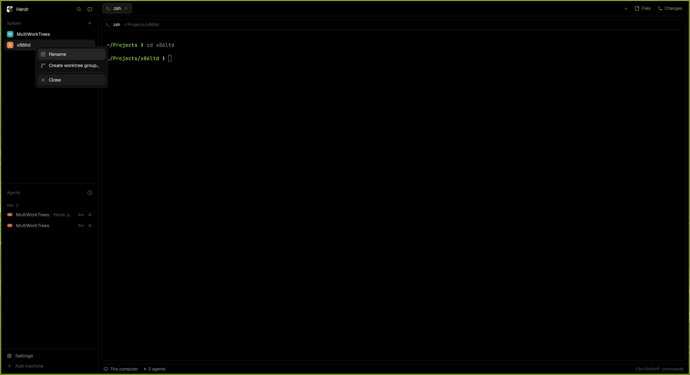

# Herdr Worktree Groups

A [Herdr](https://herdr.dev) mod that turns a folder holding several git repositories into a **worktree group**:
one Space with a git worktree of each chosen repo on a shared branch, plus the agent files
(`AGENTS.md`, `.skills`, ...) that live next to your repos.

```
~/Projects/UMG/            <- your parent folder (not a git repo)
  a/  b/  c/               <- repos
  AGENTS.md  .claude/      <- shared agent setup

~/.herdr/worktrees/groups/UMG/feature-x/     <- the group
  a/  b/                   <- git worktrees on branch feature-x
  AGENTS.md  .claude/      <- copies of the files you chose
  .herdr-worktree-group.json
```



## Using it

Right-click a Space in the sidebar, or use the **+** button in the tab bar (**New worktree group…**, for the
active Space's folder).


- **Create worktree group from folder** (on a folder that is not a git repo): type a name (it is also
  the branch name), tick the repos (none are ticked by default) and the files to copy (agent files
  are ticked by default). A group with no repos is valid. Each repo shows whether its branch is new,
  existing, remote-only (will track it) or in use (blocked).
- **Edit group repos**: tick to add, untick to remove. A review screen lists what will happen first.
- **Sync shared files**: copies the files chosen at creation again, overwriting same-named ones.
- **Open worktree group…** (Space menu, and the tab bar's **+** menu): lists your groups (open ones are
  marked) and opens a Space on the one you click, or switches to its Space if it is already open. Use it
  to bring back a group whose Space you closed. Groups made in the older sibling layout are not listed.
- **Archive worktree group**: moves the whole group to `<groups>/.archive/...` and closes its Space. Nothing
  is deleted: uncommitted changes, copied files and branches are kept.
- **Archived worktree groups…** (Space menu, and the tab bar's **+** menu): lists the archives with their
  repos and any uncommitted work. **Restore** moves a group back and opens its Space; **Delete permanently…**
  (with its own confirmation and a Force option for uncommitted changes) is the only way a group is deleted.
  Branches are never deleted; clean them up with git.

Groups live in `<worktrees.directory>/groups/<parent folder name>/<group>` (Herdr's
`worktrees.directory` setting, default `~/.herdr/worktrees`). Two parents with the same folder name get
a short hash on the second. Everything runs as `git -C <path> ...` with argument arrays, never through a
shell, so paths with spaces are safe.

## Install

```sh
./install.sh --layout
herdr-app do layout.switch '{"name":"main-wg"}'
```

This copies `worktree-group` (the mod) and `spaces-wg`, `tabs-wg`, `new-menu-wg` (below) into `~/.config/herdr-app/mods`, checks
them with `herdr-app check`, and with `--layout` adds the `main-wg` layout. Press `ctrl-alt-shift-escape`
in Herdr to fall back to the default layout if anything misbehaves.

### Why cloned mods?

Herdr's shipped mods and layouts are read-only, and the Space right-click and the tab bar's **+** open
shipped mods. So three small clones, each with one change (Herdr v0.1.16):

- `spaces-wg`: Herdr's `spaces` sidebar; right-click opens `worktree-group` instead of `menu` (whose standard
  items are reproduced there).
- `tabs-wg`: the `tabs` bar; **+** opens `new-menu-wg`.
- `new-menu-wg`: the `new-menu` popup with an extra **New worktree group…** row.

`layouts/main-wg.json` is Herdr's `main` layout pointing at `spaces-wg` and `tabs-wg`. If your layout is your own clone, change its sidebar block's `mod` to
`spaces-wg`, or make the same one-line change in your sidebar clone (`mod: "worktree-group"`,
`props: { mode: "menu", tab: "space", target: { id } }`).

## Development

```sh
npm test    # Node's built-in runner, real git in temp folders, no dependencies
```

The logic is in `mods/worktree-group/lib.js` (no Herdr imports, so it is unit tested); `main.js` is the UI.
The dialogs need Herdr itself: use `herdr-app check mods/worktree-group` and try them in the app.

## Limits

- Local Spaces only (remote machines are not supported).
- Uses `find`, `cp`, `rm` and friends: Linux, and probably macOS (CI runs both). Windows is not supported yet.
- Design notes for archiving: `docs/archive-feature-plan.md`.
