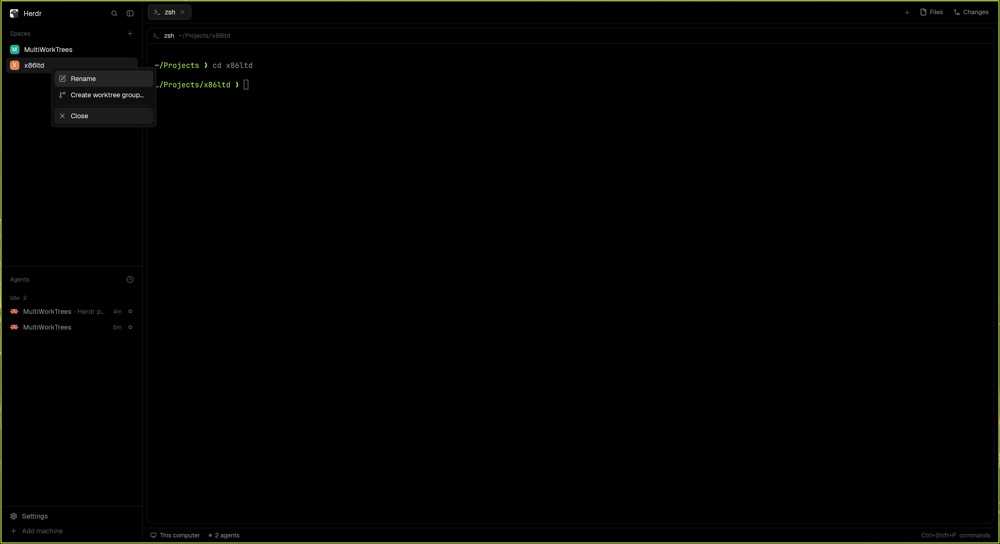

# Worktree Groups

Right-click a Space and turn a folder that holds several git repos into a **worktree group**: one Space
with a git worktree of each chosen repo on one shared branch, plus the agent files (`AGENTS.md`, `.skills`,
...) that sit next to the repos. Groups can be edited, synced and deleted from the same menu.

## What you see

The Space right-click menu (a popup, 270px wide, Herdr's popover colors, 31px rows, 14px muted icons) with
the stock items (Rename, New/Open/Remove worktree for git spaces, Close) plus:

- on a folder that is not a git repo: **Create worktree group from folder**;
- on a group Space: **Edit group repos**, **Sync shared files**, **Archive worktree group**, **Open worktree group…**, **Archived worktree groups…**;
- on a non-git, non-group Space: also **Open worktree group…** and **Archived worktree groups…**; the tab bar's
  **+** menu has the same two rows (popup 605px tall).

Dialogs (480px wide, popover background, 18px padding, 15px semibold title, "Esc" hint on the right, the
folder path in dim 11px text under the title):

- **Create:** a name input (required, empty at first, also the branch name), the target path line, a
  **Repositories** checklist (none ticked) and a **Files and folders to copy** checklist (agent files ticked),
  a hint line, then Cancel / Create. Each repo row has a second line: "new branch from main" (dim),
  "branch exists: will be checked out" or "exists on origin/x: will track it" (amber),
  "branch in use at <path>" (red, row greyed and not tickable).
- **Edit group repos:** every repo of the source folder, the group's repos ticked, "Will add: ... Will remove: ..."
  under the list, then **Review changes...**. The review step lists adds and removals (removals in the red
  `blocked` color), shows a Force checkbox when something is removed, and has Back / Cancel / Confirm and apply.
- **Sync shared files:** lists the stored files and warns that same-named files are overwritten.
- **Archive worktree group:** a confirmation saying nothing is deleted, listing repos with uncommitted changes
  (they move along), button **Archive group**.
- **Open worktree group** (600px wide): one clickable card per active group (name, "open in a Space" in the
  `working` color or dim "closed", repos, path). A click opens a Space on the group (`space.new`) or selects the
  Space already showing it (`space.select`). Found by scanning `<groupsRoot>/*/*` for the metadata file.
- **Archived worktree groups** (600px wide): one card per archive (name, archived date, repos, path, amber
  "Uncommitted changes in: ..."), buttons **Restore** and a red-outlined **Delete permanently…** that opens a
  confirmation (what is removed, uncommitted work in red, Force checkbox) with Back / Close / **Delete permanently**.

## How it behaves

- A group lives in `<worktrees.directory>/groups/<parent folder name>/<group name>` (Herdr's
  `worktrees.directory`, default `~/.herdr/worktrees`; `feat/x` becomes folder `feat-x`). A second parent
  folder with the same name gets `<name>-<6 char hash of its path>`.
- `.herdr-worktree-group.json` in the group: `{ version: 1, sourceParentPath, branchName, repos: [...], copied: [...] }`.
  A group is recognised by this file, found by walking up from the Space's current folder (8 levels).
- Create: `git -C <repo> worktree add [-b] <group>/<repo>`; existing branch: checked out; remote-only branch:
  `--track -b`; stale registrations are pruned first; if any repo fails everything is rolled back (worktrees,
  new branches, folder). Chosen files are copied with `cp -a`; folders merge into existing folders.
- A group may have no repos. Removing every repo leaves an empty group. Edit removes first, then adds; a repo
  that fails does not stop the others; failures show an error toast with git's message, and a dirty worktree
  hints at Force.
- Sync re-copies only the files chosen at creation, overwriting; nothing is deleted.
- Archive moves the group to `<groupsRoot>/.archive/<parent>/<group>` (`-2`, `-3` when taken): each repo with
  `git worktree move`, falling back to `mv` + `git worktree repair` when git refuses (submodules); everything else with
  `mv`; all moved back on failure. The metadata gets `archived`, `archivedAt`, `archivedFrom`; the Space closes.
- Restore moves it back to `archivedFrom` (refused if that folder exists) and opens a Space on it.
- Delete permanently (archive screen only) removes the worktrees (`git worktree remove [--force]`), the copied files, the
  metadata and the folder (only if empty). If any worktree fails, nothing else is removed. Branches are never deleted.
- Local Spaces only; remote spaces get no group items.

## Built from

- `mods/worktree-group/` (`mod.json` `{ "place": "none" }`): `lib.js` has all logic with injected `exec` /
  `readTextFile` / `writeTextFile` and no `herdr` imports (unit tested); `main.js` is one `View` with modes
  `menu | create | edit | sync | archive | archives | open`, opened with `openOverlay({ mod: "worktree-group", kind: "popup" | "dialog", props })`.
- `mods/tabs-wg/` and `mods/new-menu-wg/`: clones of `tabs` and `new-menu`; the tab bar's **+** opens `new-menu-wg`,
  which adds a **New worktree group…** row (opens `worktree-group` with `{ mode: "create", space, folder }`, the active
  Space and focused pane folder; the popup is 270px wide and 543px tall).
- `mods/spaces-wg/`: a clone of Herdr's `spaces` sidebar (`herdr-app do mod.clone '{"name":"spaces","as":"spaces-wg"}'`)
  where `menu(w)` opens `worktree-group` with `{ mode: "menu", tab: "space", target: { id } }` instead of `menu`.
- `layouts/main-wg.json`: a clone of the `main` layout (`layout.clone`) whose spaces block uses `spaces-wg` and whose tab bar block uses `tabs-wg`.
- `herdr` functions: `exec`, `readTextFile`, `writeTextFile`, `spaces`, `panes`, `openOverlay`, `closeOverlay`, `props`,
  `run` (`space.new`, `space.close`, `space.rename`), `notify`, `theme`, `appHome`, `home`. `gpui-base` `InputState`/`Input`.
- Programs run: `git`, `find`, `test`, `cp`, `mkdir`, `rm`, `rmdir`. Everything passes argument arrays, never a shell.
- Reads `settings.json` (`worktrees.directory`); writes only inside groups and the source repos' git metadata.

## Watch out

- Shipped mods and layouts are read-only and replaced on start, so the sidebar must be a clone; keep `spaces-wg`
  and `main-wg` in sync with Herdr's versions when they change.
- `herdr-app check` does not render dialogs or run async work: test the flows in the app and with `npm test`.
- `cp -a src dst` onto an existing folder nests it; the mod copies folder contents (`src/.`) instead.
- A symlink to a repo is a shared file, not a repo. Hidden entries are listed as files.
- `git worktree list --porcelain` blocks marked `prunable` must be ignored when checking if a branch is in use.
- Linux and macOS tools only; Windows would need PowerShell equivalents.

## Done when

- `npm test` passes (real git in temp folders, paths with spaces).
- `herdr-app check mods/worktree-group` and `mods/spaces-wg` pass.
- Right-clicking a plain folder Space shows Create; the Create button stays disabled until a valid name is typed.
- Creating a group with repos a and b makes `<root>/groups/<parent>/<name>/{a,b}` on one branch, copies the ticked
  files, writes the metadata and opens a Space on it.
- A branch already checked out elsewhere shows red and cannot be ticked.
- Edit group repos adds and removes repos only after the review step; Archive moves the group aside without losing
  uncommitted work and closes the Space; the archive screen restores it or deletes it permanently.
